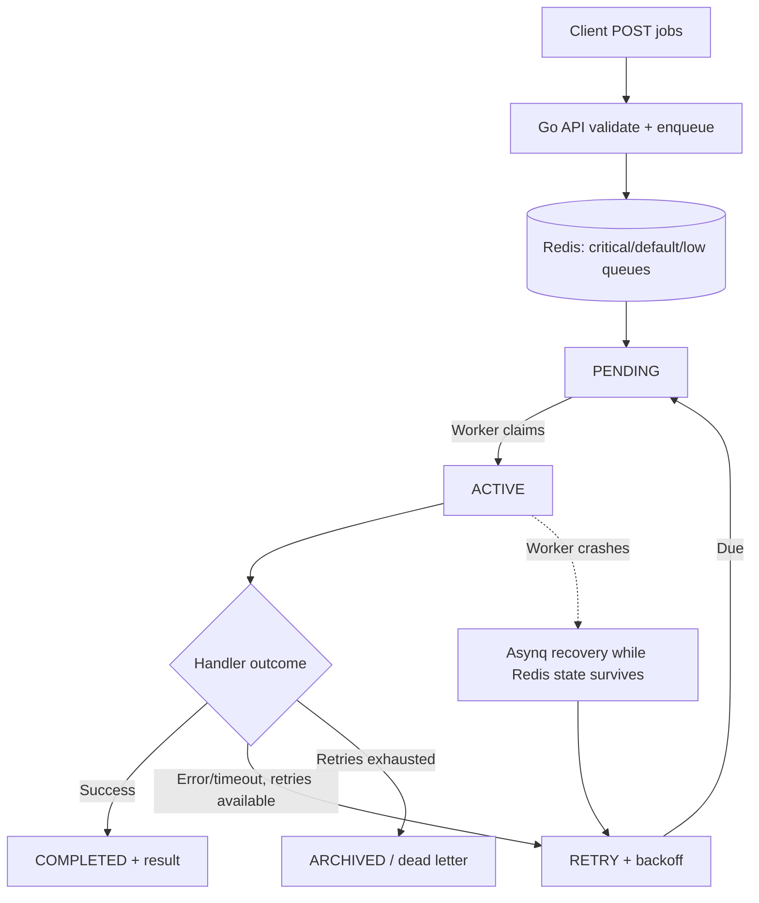

# go-async-jobs V2: scheduling and metrics

**This `v2` branch is an isolated upgrade; the original `main` deployment is unchanged.** Read [V2 setup, scheduling, cron and metrics guide](V2.md) first. V2 binds the API only to `127.0.0.1:8082` and uses a separate Compose project and Redis volume.

---

# Go Asynchronous Jobs API

A Go REST API with independently scalable workers using Redis + Asynq, weighted priority classes, exponential retry/backoff, per-attempt timeout, Redis-backed archived dead-letter tasks, status/results and operational drain/resume.

## Quick start in WSL (one command)

**Prerequisite:** Docker Compose works inside WSL (enable Docker Desktop's WSL integration). No separate Go/Redis installation is needed.

```bash
git clone https://github.com/gamaheshwari246/go-async-jobs.git
cd go-async-jobs
bash run.sh
```

This builds the Go API and worker Docker images and starts **Redis + API + two workers**. Check http://localhost:8080/healthz.

| Command | Action |
|---|---|
| `bash run.sh` | Build and start everything |
| `bash run.sh build` | Compile Docker images only |
| `bash run.sh test` | Run formatting, all Go unit/integration tests (including SIGKILL recovery), vet, build |
| `bash run.sh logs` | Stream API and worker logs |
| `bash run.sh status` | Show containers |
| `bash run.sh stop` | Stop containers (keeps Redis volume) |

You may use `./run.sh` instead after `chmod +x run.sh`. **Warning:** integration tests clear disposable Redis DB 12, 13 and 14; use a disposable/local Redis. They do not clear the normal API's DB 0.


Submit a job (the server generates the job ID):

```bash
curl -i -X POST http://localhost:8080/jobs \
  -H 'Content-Type: application/json' \
  -d '{"type":"demo.sleep","payload":{"duration_ms":250,"fail_first":0},"priority":9,"max_retries":3,"timeout_seconds":5}'
```

The API replies HTTP 202 with `job_id` without waiting for handler execution. Read `GET /jobs/{id}` for state, attempts, last error and result, and `GET /queue/depth` for waiting/active/archived counts.

Operational drain (rejects new submissions, lets accepted jobs finish):

```bash
curl -X POST http://localhost:8080/admin/drain -H 'Authorization: Bearer local-dev-token'
curl -X GET http://localhost:8080/admin/drain -H 'Authorization: Bearer local-dev-token'
curl -X POST http://localhost:8080/admin/resume -H 'Authorization: Bearer local-dev-token'
```

## Worker and job configuration

`REDIS_ADDR` (default `127.0.0.1:6379`), `WORKER_CONCURRENCY` (default 5; range 1–100), `HTTP_ADDR` (default `:8080`), `WORKER_HEALTH_ADDR` (default `:8081`, internal to each worker container) and `ADMIN_TOKEN` (required for admin API) configure the two processes. Docker Compose sets a development-only admin token; replace it outside local development. Scale workers using `docker compose up -d --scale worker=4`.

Priority is 0–9, default 5. 0–3 maps to `low` (weight 1), 4–6 to `default` (weight 3), 7–9 to `critical` (weight 6); numeric priorities are **not strictly ordered**. Asynq scans scheduled/retry tasks every **1 second** (rather than its 5-second default); execution remains best-effort and depends on worker capacity. `max_retries` is 0–10 (default 3). `timeout_seconds` is 1–300 (default 30). Payload limit is 16 KiB. The demonstrated handler types are `demo.sleep` and `demo.effect`.

## Full lifecycle



**Redis stores tasks and their lifecycle state; Asynq manages transitions.** Queue names describe weighted priority. States describe whether each job is pending, executing, delayed for retry, completed or dead-lettered. `max_retries=N` means an initial attempt plus up to N **ordinary** error retries, not a strict bound on crash recovery or external side effects. Archived jobs remain queryable while their records are retained.

## At-least-once and idempotency

Once Redis acknowledges enqueue and retains its state, Asynq retries failed or interrupted work; **the handler can execute more than once**. Worker 1 could commit a business effect and crash before marking success; Worker 2 can then repeat the job. Stable server-generated job IDs and attempt logs help identify repeats. The `demo.effect` handler demonstrates a Redis-local effect protected by atomic `SETNX`: first attempt stores an effect and deliberately fails; the retry sees the effect and returns successfully without storing it twice. This **does not** guarantee exactly-once external API payments/emails. Those require transactional or downstream-enforced idempotency. Redis AOF `appendfsync everysec` can lose the most recent acknowledged writes in a hard crash.

An optional HTTP `Idempotency-Key` header reduces duplicate **submission** when the client retries a POST; it is **not required** and is separate from worker-level idempotency. Its matching is not a long-lived, globally atomic registry. See [IDEMPOTENCY.md](docs/IDEMPOTENCY.md) for both problems and [ARCHITECTURE.md](docs/ARCHITECTURE.md) for the failure matrix.

## Run 25 deployment verification tests

The executable [25-test deployment runner](scripts/verify_deployment_25.sh) checks the live API: liveness/readiness, asynchronous job results, queue depth, priority routing, defaults, retries/backoff, dead-lettering, timeouts, idempotency, input validation, worker count, and admin drain/resume.

From your laptop (requires `curl`, `jq`, and `awk`):

```bash
git pull origin main
BASE_URL=http://146.190.95.143:8080 bash scripts/verify_deployment_25.sh
```

Tests **1–23** run automatically, creating only small demonstration jobs (including intentionally failing jobs). Tests **24–25** are privileged and **SKIP** unless explicitly enabled. To run those from a machine with SSH key access to the Droplet:

```bash
BASE_URL=http://146.190.95.143:8080 \
SSH_HOST=root@146.190.95.143 RUN_PRIVILEGED=1 \
bash scripts/verify_deployment_25.sh
```

Test 24 reads the remotely deployed worker/API counts (expects at least 4 workers and one API); it does not change worker scale. Test 25 performs drain/reject/resume **only over SSH to the Droplet's localhost**, automatically attempting resume on failure. It deliberately skips when the Droplet still has the Compose development-default admin token. Do **not** expose admin tokens or an unauthenticated production job submission endpoint to the internet. Restrict public port 8080 to your IP with a DigitalOcean Cloud Firewall or use an SSH tunnel.

CI exercises tests 1–23 against its own disposable Docker Compose stack and reports 24–25 as skipped; it does not target a public Droplet.

## Tests and CI

```bash
go mod tidy
go test -race ./...
# Use a disposable Redis instance: integration tests flush DB 12, 13 and 14.
docker run -d --name redis-test -p 6380:6379 redis:7.4-alpine
REDIS_TEST_ADDR=127.0.0.1:6380 go test -race -tags=integration -count=1 ./...
go vet ./...
go build ./cmd/api ./cmd/worker
```

GitHub Actions (`.github/workflows/ci.yml`) runs the Redis integration suite with race detection, `go vet`, and builds on each push and pull request. Integration tests cover success/results, transient retry, exhaustion/archive, handler panic, timeout, drain/resume and Redis-local idempotency; a separate integration test kills a real worker subprocess with SIGKILL after recording a Redis effect, starts a fresh worker, and asserts recovery, completion and one effect (while Redis state survives).


## Health and readiness

- API `GET /healthz` is a **liveness** check (HTTP process running); `GET /readyz` is a **readiness** check that pings Redis with a 1-second timeout, returning 503 when unavailable.
- Every worker exposes **internal-only** HTTP health on `WORKER_HEALTH_ADDR=:8081`: `/healthz` reports process liveness, while `/readyz` reports a recent successful Asynq Redis health check. Worker readiness becomes healthy after the first successful check and is considered stale after 20 seconds. This checks broker connectivity, not job throughput or handler correctness.
- The minimal runtime Docker image includes a tiny compiled Go HTTP probe (no shell/curl dependency), and Docker Compose checks API and worker readiness. `bash run.sh status` shows health states.

## Structured logs

Both processes write one JSON object per event to standard output using Go's `log/slog`:

- **API:** `http_server_starting`, `http_request_finished` (method/path/status/latency), `job_enqueued` (job ID, queue, priority, retry limit, timeout), `submission_deduplicated`, `job_enqueue_failed`, `admission_draining`, `admission_resumed`, and shutdown events.
- **Worker:** `worker_starting`, `job_started`, `job_succeeded`, `job_failed`, `job_retry_scheduled`, `job_cancelled`, `effect_committed`, `duplicate_effect_suppressed`, and shutdown events.

Worker events include job ID, queue, task type, attempt and elapsed milliseconds wherever available. HTTP request logs include status and latency. **Task payloads and authorization headers are not intentionally logged.** Errors can nevertheless contain sensitive downstream details and should be sanitized in real business handlers.

Inspect logs with:

```bash
docker compose logs -f api worker
```

Go tests also cover idempotency reservation transitions and concurrent leases against **disposable Redis DB 12**, plus worker readiness and the production retry polling interval. The Go source is formatted with `gofmt`. CI checks formatting before running the race-enabled full suite.

## Operational limits and future migration

The running service remains **Redis + Asynq**. Redis is configured with a 256 MiB `maxmemory` ceiling and `noeviction`: it rejects new writes under memory pressure instead of silently deleting queued jobs. This is **not** a queue admission quota; processing may also be affected by exhausted Redis memory. Tune memory for actual workloads. Workers have a 330-second Asynq shutdown timeout and a 350-second Compose stop grace period for handlers configured up to 300 seconds. Forced process kills and unsafe external side effects can still cause redelivery. Archived/dead-letter tasks are not permanent records; Asynq can prune archived data.

For a higher-scale deployment **we would evaluate RabbitMQ plus PostgreSQL**, with RabbitMQ consuming work and PostgreSQL serving as the durable job/status/result source of truth. A transactional outbox and publisher would bridge the database-to-broker crash window, and a consumer inbox/idempotent transaction would protect business effects. This is a *proposed architecture*, not an implemented migration, and not an unconditional replacement for Asynq. See [future production architecture](docs/FUTURE_PRODUCTION.md) and [queue options](docs/QUEUE_OPTIONS.md).

The optional HTTP idempotency registry is queue-independent and rejects the same key reused with a different job configuration. A Redis reservation is **not atomic with Asynq enqueue**, but a **five-second claim lease** makes an abandoned reservation recoverable when the client retries: before enqueue, the next retry reclaims the expired lease; after enqueue but before confirmation, the retry inspects Asynq and returns the original job ID. While a claim is live and its task is not yet visible, the API returns retryable **503** with `Retry-After: 1`. Same-key conflicting requests return **409**, and committed records whose task has expired return **410**. Reservations expire after 48 hours; this is not a durable permanent request ledger and no background recovery publisher is installed.

## What breaks first under load?

**Redis memory headroom is essential.** `maxmemory 256mb` with `noeviction` protects stored tasks from arbitrary eviction, but when Redis reaches its cap it can reject **completion, retry, and archive state writes**, not just new enqueues. The API cannot assume that a full broker still processes previously accepted work normally. For the demo, monitor `used_memory`, `maxmemory`, `mem_fragmentation_ratio`, persistence errors, command failures, queued age, and alert **well before the cap** (for example at 70%/85% of configured memory). These are recommended alert thresholds, not implemented Prometheus alerts. Size Redis and memory headroom from measured load. The 256 MiB cap is a local demonstration default, not a production sizing recommendation.


Sustained throughput above worker capacity grows Redis waiting queues, archived records and completed-result memory. Bounded worker concurrency does **not** bound queue depth. Repeated retries increase pressure; Redis persistence can become an availability/durability bottleneck. Monitor queue age/depth, throughput, worker utilization, retry/dead-letter rates and Redis memory. Hard backlog admission, stronger durability and longer-lived result storage are production hardening options; they are not present in this interview-scale implementation.

## Engineering scope

See [requirements mapping](docs/REQUIREMENTS.md), [full architecture](docs/ARCHITECTURE.md), [idempotency design](docs/IDEMPOTENCY.md) and [alternative queue technologies](docs/QUEUE_OPTIONS.md). Known limitations are documented rather than claimed as solved.
