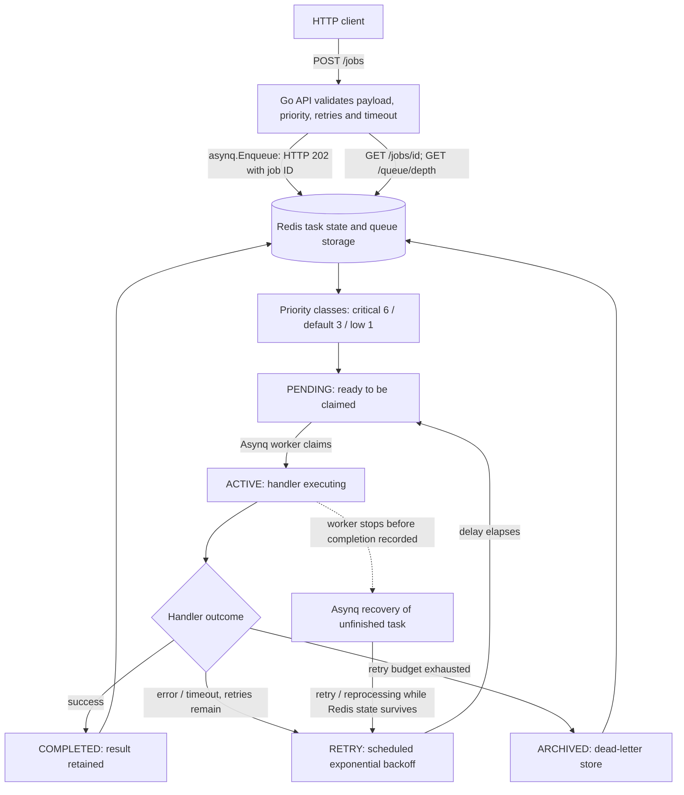
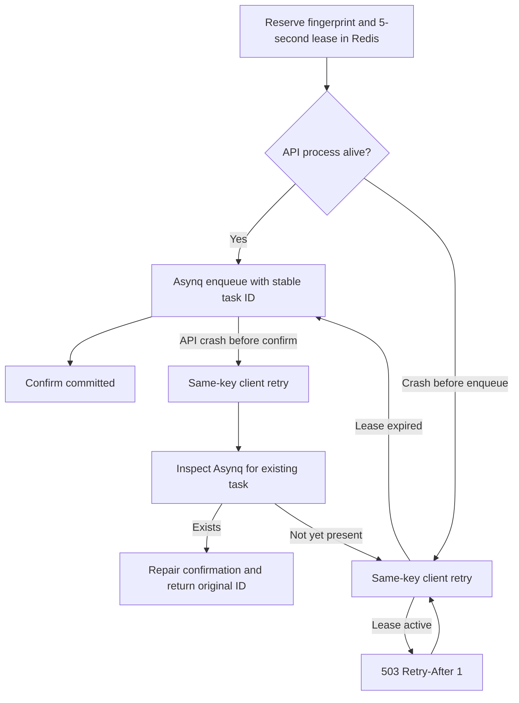

# Architecture, task lifecycle and reliability

## Full flow

**Queue versus state:** Redis is the backend for all task data. The task's queue name (`critical`, `default` or `low`) determines weighted worker selection; its state (`pending`, `active`, `retry`, `completed`, `archived`) records lifecycle progress. Asynq owns Redis task structures and transitions. A job is **not permanently deleted when claimed**; it becomes active so interrupted work can be recovered. The API has no in-process execution queue or background worker.

## Exact application flow

1. `POST /jobs` validates job type/payload, priority 0–9, max retries 0–10 and timeout 1–300 seconds. The server/Asynq assigns the job ID unless an **optional** `Idempotency-Key` is used, in which case a deterministic task ID is requested. Successful Redis enqueue returns HTTP 202 immediately.
2. Each priority maps to a named Redis queue: 0–3 low, 4–6 default, 7–9 critical; worker weights are 1:3:6. This is **weighted**, not strict ordering of numeric priorities. Worker concurrency is configured independently.
3. Asynq claims an eligible pending task and marks it active. The Go handler runs with a per-attempt timeout. A successful result moves to completed; `Retention(24*time.Hour)` is configured for successful results.
4. Ordinary handler error or cooperative timeout: Asynq retries according to configured max retries and exponential delay with bounded jitter. While delayed, the task is in retry state; when due, it becomes eligible for execution again. A retrying task is exposed as public `failed` (nonterminal), completed as `succeeded`, archived as `dead_lettered`.
5. Once the ordinary retry budget is exhausted, Asynq places the task in its Redis **archived** state, which serves as the dead-letter store. It preserves associated failure details while retained; this is not a separate custom DLQ or permanent archive.
6. `GET /jobs/{id}` reads Asynq task state, attempts, last error and result; `GET /queue/depth` sums pending + scheduled + retry as waiting, separately reporting active, archived and retained completed counts.
7. `POST /admin/drain` rejects new requests through a shared Redis flag while accepted and active tasks continue; `/admin/resume` reopens admission. Drain admission is best effort, not atomic with enqueue.

## At-least-once delivery: what is guaranteed and what is not

**Provided Redis retains the task**, Asynq retries failed work and can recover work abandoned by an interrupted worker. A successfully enqueued task is therefore intended for **at-least-once execution, not exactly-once execution**. Execution cannot be promised if Redis permanently loses acknowledged task data, no workers ever become available, tasks are administratively deleted, or permanent failure leads to archived terminal state. A permanently failing task is not guaranteed to succeed; at-least-once concerns attempts, not successful results.

- **Ordinary handler error:** a failed attempt can be rescheduled after exponential backoff; `max_retries=N` allows the initial attempt plus up to N standard retries (e.g. N=2 gives up to three ordinary attempts).
- **Timeout:** Asynq cancels the handler context. The handler must respect cancellation; cancellation cannot undo an already completed external effect.
- **Worker process crash:** if a worker completes an effect but dies before Asynq records success, recovery may execute the same job again. Recovery timing depends on Asynq's unfinished-task mechanisms. A Redis-backed integration test now kills a real worker subprocess with SIGKILL after a Redis effect is stored, before completion ACK; a restarted worker recovers the job and verifies no second Redis effect is committed. This establishes this crash-recovery scenario, not all possible crash timings.
- **Redis outage during enqueue:** the API returns an error rather than promising acceptance. An uncertain network response can still leave the client unsure whether Redis accepted a request.
- **Redis process/host loss:** Compose enables Redis AOF with `appendfsync everysec`, which can lose recently acknowledged data on a hard crash and therefore is **not an unconditional durability guarantee**.
- **Retry limits:** N limits ordinary failure retries, but does **not** prove an absolute lifetime bound on all process-crash recoveries, duplicate external effects or retries by the HTTP client.
- **Dead letter:** exhausted jobs are archived (not silently discarded), but archive retention is subject to Redis/Asynq operational limits.

## Duplicate execution versus duplicate business effects

The server-generated Asynq job ID is stable across worker attempts. Log the ID and retry count to **detect** repeated execution. This does not prevent repeated execution. The `demo.sleep` handler is harmless if repeated. The implemented `demo.effect` handler uses Redis `SETNX` with a key derived from the stable job ID, then deliberately returns an error **after** storing its Redis-local effect on the first execution. On retry it detects the existing key and does not record that Redis effect a second time. The integration test checks the successful retry and existence of the effect record.

This is a **Redis-local demonstration only**, not an exactly-once external payment/email guarantee. For a downstream API, use provider-enforced idempotency with a stable business key; for our own transactional database, atomically commit the deduplication record and business change together. Redis `SETNX` before an unrelated external call can incorrectly suppress an effect if a crash happens between the two.

**Optional HTTP submission deduplication:** `Idempotency-Key` is implemented but not required by the assignment. It deals with client re-submission and is independent of worker retries. A Redis Lua reservation now serializes the same idempotency key across priority queues. Its five-second claim lease permits client-driven recovery of a crashed API before enqueue; if Asynq already accepted the job, a retry inspects and repairs the reservation. The reservation lasts 48 hours. No background sweeper is implemented; the client must retry, and Redis durability/retention still constrain guarantees. Details in [IDEMPOTENCY.md](IDEMPOTENCY.md).

## Failure scenarios and tests

| Scenario | Current behavior | Test coverage |
|---|---|---|
| Handler succeeds | Completed, retained result | Redis integration |
| Transient handler error | Retry, then success | Redis integration |
| Retry exhaustion | Archived / dead-lettered with last error | Redis integration |
| Timeout / cancellation | Failure and retry/archive | Redis integration |
| Handler panic | Failure recorded / archived | Redis integration |
| Duplicate Redis-local effect after retry | Second attempt observes same Redis key | Redis integration |
| Repeated HTTP submission with key | Same task ID when retained, conflict on changed payload | Redis integration |
| Worker process killed between effect and ACK | A fresh Asynq server recovers and finishes the job; SETNX prevents a duplicate Redis-local effect | **SIGKILL integration tested** |
| Redis host loses recent AOF writes | Potential accepted-job loss | **Not fault-injection tested** |
| Two conflicting submissions on different priority queues | Queue-independent Redis Lua reservation returns conflict | Redis integration tested; reservation/enqueue crash window remains |

## What breaks first under load?

Sustained arrivals faster than completions increase Redis waiting tasks, retained results and archived-job memory. Bounded `WORKER_CONCURRENCY` does **not** bound the backlog. Retry storms and very large payloads worsen memory/CPU use; API validation caps payloads and retries but does not enforce a hard global backlog limit. Monitor queue waiting age/depth, worker utilization, Redis memory/persistence latency, retry/archive rates, and p95 completion latency. Strict admission control, quotas, result archival, stronger Redis durability and tracing are further hardening work.

## Known limitations

No permanent audit log, no exhaustive failure-injection matrix, no strict atomic drain fence, no durable external-side-effect transaction, no unconditional Redis data durability, no strict 0–9 priority ordering, no permanent job status beyond retention, and no truly global request-idempotency registry.

## Operational improvements and remaining gaps

Worker shutdown now allows up to 330 seconds before Asynq cancels inflight jobs; Compose gives workers 350 seconds for graceful stop. Redis uses 256mb `maxmemory` with `noeviction`, which avoids silent queue-item eviction but causes write failures at capacity. The optional HTTP idempotency key uses a queue-independent Redis reservation with a 48-hour expiry; reservation and enqueue are not one transaction, so an interrupted request may produce a temporary orphan reservation. See [FUTURE_PRODUCTION.md](FUTURE_PRODUCTION.md) for the prospective RabbitMQ/PostgreSQL design.

## HTTP submission recovery (optional Idempotency-Key)

This fixes the former 48-hour temporary orphan-reservation blocking behavior for a retrying client, **without** introducing RabbitMQ. The short claim lease allows recovery after an API crash before enqueue, and inspector-based reconciliation handles an enqueue that succeeded before confirmation. This does not remove Redis persistence limitations, finite task retention or the need for a client retry. See [IDEMPOTENCY.md](IDEMPOTENCY.md).

## Health and retry scheduling

The API provides `/healthz` (process alive) and `/readyz` (Redis ping within one second). Each worker has an internal `:8081` HTTP liveness/readiness endpoint; readiness requires a successful Asynq Redis health check within the last 20 seconds. Docker Compose probes both API and workers using a compiled Go healthcheck binary. Readiness means Redis connectivity, **not** proof that tasks are making progress. Worker `DelayedTaskCheckInterval` is configured to one second; actual retry execution can be later because the queues and workers may be busy. A unit test asserts the production configuration.

Redis is configured with `maxmemory 256mb` and `noeviction`. Under exhaustion, task completion, retries and archival writes can also fail: do not confuse this with a safe global admission cap. Maintain operational headroom and alert on memory/Redis write errors before reaching the limit. CPU, AOF latency, and backlog age still require monitoring; external alerting is not yet deployed.
