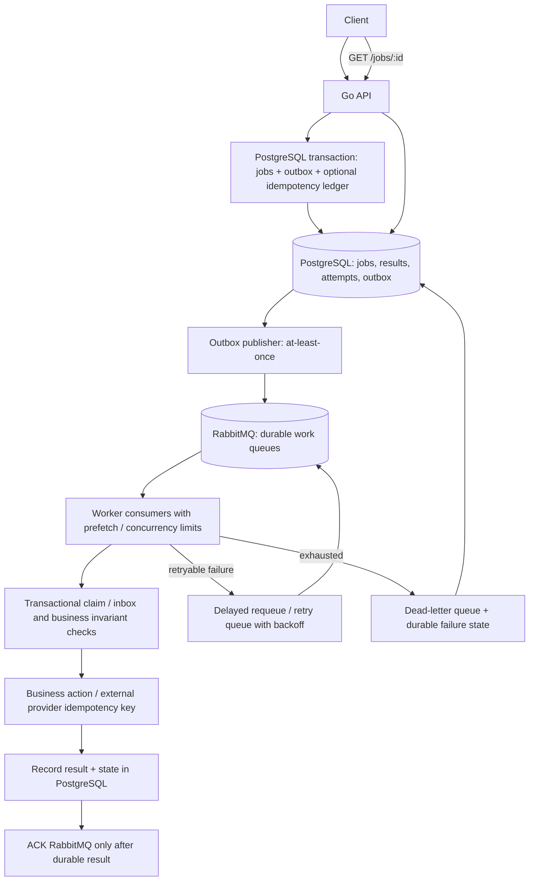

# Prospective production architecture (not implemented)

The current running code is **Go + Redis + Asynq**. Keep it for the take-home assignment unless requirements justify a migration. Do not represent the design below as deployed.

## Possible scale-up: RabbitMQ + PostgreSQL

### Why both a broker and a database?

RabbitMQ transports and distributes work, supports acknowledgements and consumer back-pressure. PostgreSQL stores queryable durable job states, results, attempt history, deduplication records and transactional outbox events. Writing the job and outbox together prevents the **database committed but broker enqueue lost** gap. The outbox publisher can publish twice; consumers must be idempotent. ACK after the business transaction and job-state commit protects against lost processing, but crashes before ACK can still redeliver. External payments/emails require a provider idempotency key or a transaction in the same business system. Use per-consumer prefetch limits, queue quotas, TTLs, dead-letter policies, metrics and explicit retention.

### When to choose another option

| Requirement | Candidate | Reason |
|---|---|---|
| Small Go job service with built-in retry/state | Redis + Asynq | Smallest operational implementation here |
| Multi-consumer jobs with durable searchable history | RabbitMQ + PostgreSQL | Broker plus separate transactional status store |
| Job creation must share the same DB transaction | PostgreSQL-backed queue | Single atomic database boundary |
| AWS-managed worker queue | SQS + DLQ + status database | Managed delivery with at-least-once semantics |
| Streaming analytics or append-only event fan-out | Kafka | Replayable partitioned log, not a natural per-job status API |
| Long-lived multi-step orchestrated business flows | Temporal | Durable workflows, timers and retries |

Migration requires new queue adapters, retry/DLQ scheduling, schema design, outbox/inbox implementation, state/API migration, operational observability and load tests. No unconditional throughput or reliability gain is claimed; choose using measured requirements.
