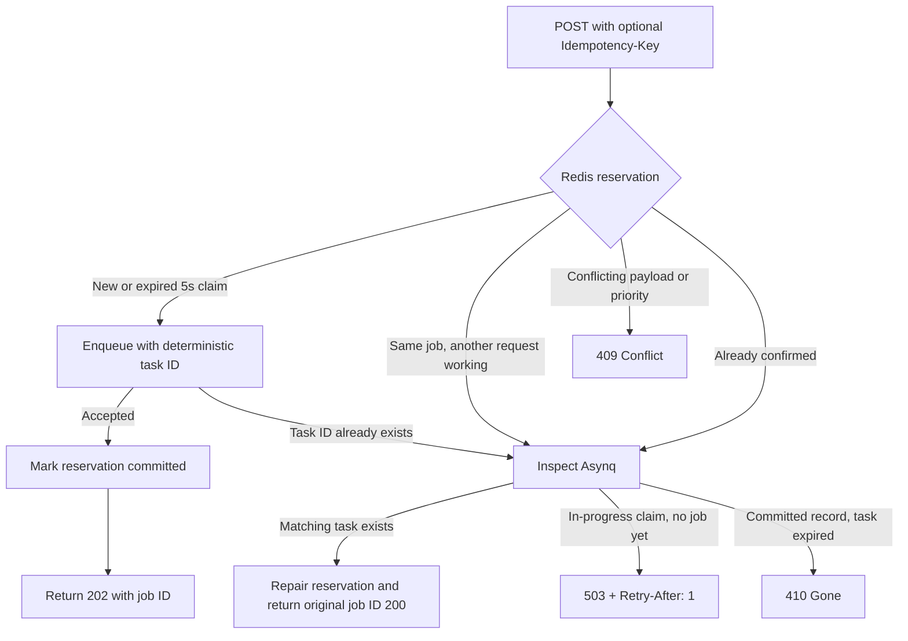

# Two independent idempotency problems

## 1. Worker-execution duplicates — assignment requirement

A client calls `POST /jobs` without supplying any special header. The server generates Job 123 and enqueues it in Redis. **Every retry/redelivery still refers to Job 123.** This identity is managed by Asynq and requires no client-supplied key.

```text
Job 123 is enqueued
   -> Worker 1 runs the handler
   -> Redis-local effect is recorded
   -> Handler fails before success is recorded
   -> Asynq retries Job 123
   -> Worker 2 sees the existing Redis effect key
   -> No second Redis effect is recorded
   -> Handler returns success
```

The implementation is `internal/handlers/effect.go`: `SETNX("go-async-jobs:demo-effects:"+jobID, payload, 7-day TTL)`. It demonstrates an **atomic, Redis-local effect**, not exactly-once handler execution. The handler intentionally returns a simulated error after its first successful `SETNX` to reproduce the gap between effect and completion; the next attempt observes the key. Tests exercise this simulated failure **and** a separate real OS-worker SIGKILL/restart scenario (in `internal/integration/crash_recovery_test.go`) that verifies recovery and a single Redis-local effect. Neither test proves exactly-once arbitrary external effects.

`max_retries` bounds standard failed attempts, but does not guarantee no repeated execution, especially during process recovery or acknowledgment loss. Stable IDs and attempt logs **detect** repeats. They do not make external calls safe by themselves.

**Critical limitation:** `SETNX` and an unrelated external payment/email API call are not atomic. Do not mark payment complete in Redis before calling the provider and mistake that flag for exactly-once payment. Use a provider idempotency key or a business-database transaction that commits the unique operation ID with the business effect. The 7-day TTL and Redis persistence limitations also bound the demo's deduplication horizon.

## 2. HTTP duplicate submissions — optional, outside the assignment minimum

Two identical `POST /jobs` calls **without** a shared key might be two intentional jobs or a retry after a lost HTTP response. The server cannot infer intent. The optional `Idempotency-Key` header allows a client to identify one logical submission across HTTP retries:

- First request: enqueue with an Asynq task ID derived from SHA-256 of the header; return HTTP 202.
- Replayed matching request while the existing task is available: return the same task ID with HTTP 200.
- Same key but conflicting request configuration, when the existing task is detected: return HTTP 409.
- A queue-independent Redis reservation rejects cross-priority-key reuse while retained (48 hours). A five-second claim lease allows the same request to recover after an API process crash.

The header is **not** used by Asynq when it retries a worker job; worker attempts already share the Asynq task ID. HTTP request deduplication is an additional convenience feature, not something explicitly requested in the assignment.

## Summary

| Concern | Key | Current capability | Caveat |
|---|---|---|---|
| Detect worker re-execution | Server-generated task ID | Asynq retry metadata + logging | Does not prevent re-execution |
| Demonstrate idempotent effect | Server-generated task ID | Redis `SETNX` for demo-local effect | Cannot protect unrelated APIs |
| Deduplicate client HTTP retries | Optional `Idempotency-Key` header | Deterministic task ID + recoverable Redis lease | 48-hour scope; Redis durability and external effects remain separate |

See [ARCHITECTURE.md](ARCHITECTURE.md) for the full lifecycle, recovery and failure matrix.

## Queue-independent reservation with crash recovery

The optional HTTP key identifies one logical submission. The API computes a deterministic Asynq task ID and reserves a Redis hash with the validated job fingerprint. A Lua script atomically coordinates this across **all priority queues**. The working handler still receives its server-generated/stable Asynq ID, not the HTTP idempotency header.



### Failure-window behavior

| API failure window | Next client retry |
|---|---|
| Crash before reservation | Creates a fresh claim and enqueues |
| Crash **after reservation, before enqueue** | Gets HTTP 503 while the five-second lease is live; afterwards it reclaims the same reservation and enqueues the same deterministic task ID |
| Crash **after enqueue, before confirmation** | Inspects Asynq, finds the matching task, repairs the reservation, returns HTTP 200 without enqueueing twice |
| Crash after confirmation | Returns the existing job ID while Asynq retains the task |
| Same key, different priority/payload | HTTP 409 throughout the reservation's lifetime |
| Job state expired but reservation is still committed | HTTP 410; do **not** replay a potentially completed business operation |

For same-key concurrent retries, the first claimant owns a short lease. Other callers either see the task already enqueued or receive a **retryable 503**, never a misleading permanent 409 for an unfinished same-body reservation. An expired claim can be taken over; all identical requests enqueue the **same task ID in the same queue**, so overlapping lease owners cannot create separate Asynq tasks while its task identity remains retained. The idempotency reservation TTL remains **48 hours**, separate from the **five-second lease**.

Tests exercise both simulated crash windows and cross-priority conflict in `internal/integration/integration_test.go`, plus the worker SIGKILL/recovery test. The original string-format Redis reservations are converted to the new hash format on the next matching request.

### Remaining boundaries

This is crash **reconciliation**, not a transaction spanning Redis reservation and Asynq's enqueue. It assumes Redis remains available and retains the task/claim. An API crash still requires the **client to retry**; no separate background sweeper publishes abandoned jobs. Expired records or Redis data loss can permit later re-submission. Arbitrary external payments/emails still require downstream business idempotency, and an interrupted client without an idempotency key remains ambiguous.

## Decision tests

The `internal/operations/idempotency/idempotency_integration_test.go` suite exercises the Redis Lua reservation against real Redis DB 12. It covers fresh reservations, live claim conflicts, mismatched payloads, confirmed tasks, observed-task repair, reclaiming expired leases, upgrading legacy string records, stale-owner confirmation rejection, and parallel contenders. The unit suite also checks Redis-unavailable errors. These test local atomic reservation transitions, **not** exactly-once delivery across arbitrary external systems.
